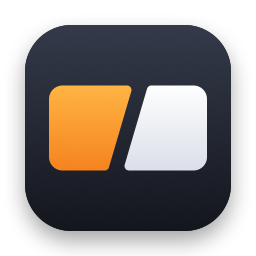
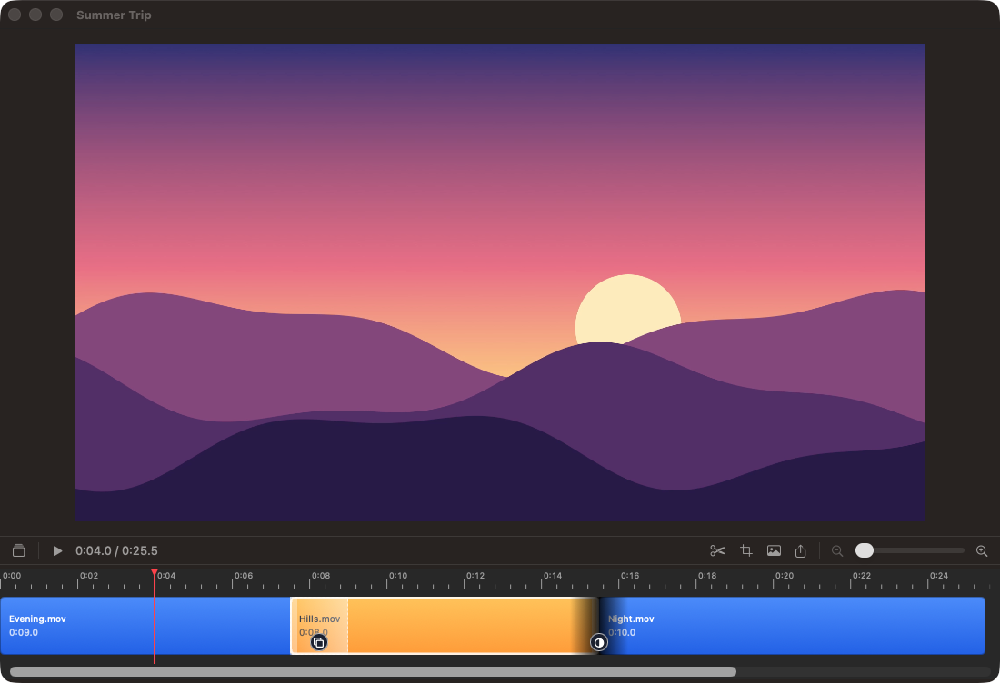
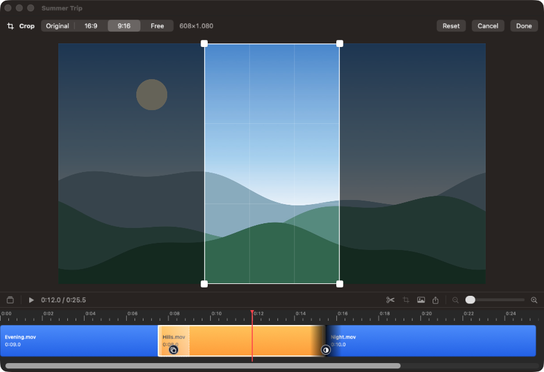
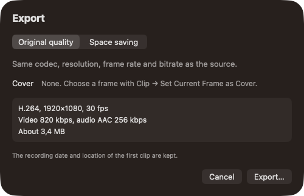
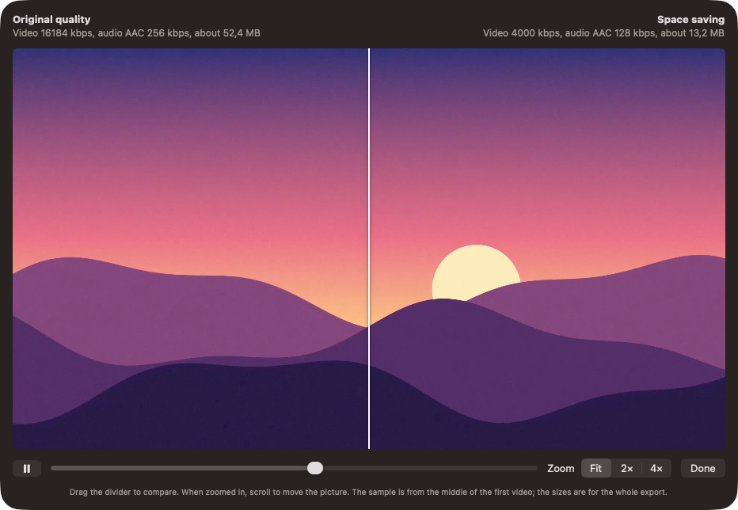

# basit-cut

A small, non-destructive video editor for macOS, made for one job: turning a personal video archive (phone clips, camera files, old recordings) into a few clean, well-kept files. Cut out the boring parts, join clips, add a fade, crop for a phone screen, and export without losing quality or the original date and location.

It is deliberately limited: one video track, two kinds of transitions, two export modes. No effects, titles or color grading.



<details>
<summary>More screenshots</summary>

**Crop**, directly on the preview:



**Export:**



**Compare**, both export modes side by side:



</details>

## Features

- **Projects:** each project is a document that only refers to your videos and stores your edits. **Your source files are never modified.** All projects live in one folder that you choose once (changeable in Settings). Autosave, versions and unlimited undo/redo are included.
- **Import:** drag videos into the window or use Import (⌘I). Anything AVFoundation can open (MOV, MP4, M4V; H.264, HEVC). You get a warning when a clip's resolution, frame rate or codec differs from the rest. Portrait phone videos are shown upright.
- **Timeline:** one track. Reorder clips by dragging, trim them by their edges, split at the playhead (⌘B), delete (⌫). ⌘-click or ⌘A selects several clips.
- **Transitions:** cross fade (⌘T) or fade through black (⇧⌘T), 0.2–5 seconds, set at the cut after the selected clip. With several clips selected, the transition goes on every cut between them, so ⌘A then ⌘T fades the whole film. The sound crossfades smoothly, like songs in a music player (at black fades too, when the videos have footage beyond the cut), and hard cuts get a tiny audio fade so they don't click.
- **Preview:** the preview uses the same composition as the export, so what you see is what you get.
- **Crop:** Original, 16:9, 9:16 or Free. Drag and resize the crop directly on the preview.
- **Cover image:** pick any frame as the cover (⇧⌘K). It is embedded in the exported file, cropped like the video.
- **Export:**
  - **Original quality:** same codec, resolution, frame rate and average bitrate as the source. Without transitions or a crop, the video is copied without re-encoding (lossless and fast).
  - **Space saving:** HEVC, at most 1080p (orientation kept), at most 4 Mbit/s and at most 60% of the bitrate of H.264 sources (HEVC needs less data), AAC audio.
  - **Compare:** plays ten seconds of the first video in both modes in one picture with a draggable divider and zoom. The sample is prepared in the background, so there is nothing to wait for.
  - Both modes keep the metadata of the first clip: creation date, location, camera make and model.
- **Missing files:** if videos were moved or a drive is disconnected, the project tells you which files are missing. You can locate each one, or pick a folder and basit-cut finds all of them by name.

## Keyboard

| Key | Action |
|---|---|
| Space | Play / pause |
| Hold L | Play at 2× while held (the key can be changed in Settings) |
| ← / → | Jump 5 seconds (hold to keep jumping) |
| ⇧← / ⇧→ | Jump 30 seconds |
| ⌘B | Split at the playhead |
| ⌫ | Delete selected clips |
| ⌘A | Select all clips |
| ⌘T / ⇧⌘T | Cross fade / black fade at the selected cuts |
| ⇧⌘K | Set the current frame as the cover |
| ⌘I | Import videos |
| ⌘E | Export |
| ⌘+ / ⌘−, ⌘ + scroll wheel, pinch | Zoom the timeline |
| ⌘N / ⌘O | New project / open project |
| ⇧⌘P | Show the projects window |

## Requirements

- A Mac with Apple Silicon
- macOS 15 Sequoia or later
- To build: Xcode 26 or later (Swift 6)

## Building from source

```bash
git clone https://github.com/atillaoezdemir/basit-cut.git
cd basit-cut
open BasitCut.xcodeproj
```

Choose the **BasitCut** scheme and press ⌘R. No Apple Developer account is needed: the app is signed ad hoc ("Sign to Run Locally").

To build a release copy from the command line:

```bash
xcodebuild -project BasitCut.xcodeproj -scheme BasitCut -configuration Release -derivedDataPath build
```

The app is then at `build/Build/Products/Release/BasitCut.app`; move it to `/Applications`.

There are no third-party dependencies.

### Opening a downloaded build

Builds aren't notarized by Apple (that needs a paid developer account), so macOS blocks a downloaded copy the first time you open it. To open it anyway:

1. Open BasitCut once and close the warning.
2. Go to **System Settings → Privacy & Security**, scroll down, and click **Open Anyway** next to the message about BasitCut.

Or remove the quarantine flag in Terminal:

```bash
xattr -dr com.apple.quarantine /Applications/BasitCut.app
```

A copy you build yourself isn't affected.

## Running the tests

```bash
swift test --package-path Packages/BasitCutKit
```

```bash
xcodebuild test -project BasitCut.xcodeproj -scheme BasitCut -destination 'platform=macOS'
```

The media tests generate their own small test videos; no personal files are needed.

## Notes

- **Cover art in Finder:** the cover is embedded as standard QuickTime artwork, and players such as QuickTime Player and Photos can show it. Finder may still use a frame of the video as the file's icon instead.
- **Passthrough export** (Original quality without transitions or crop) copies the audio as is, so the tiny click-preventing fades at hard cuts are not applied there.
- The app runs in the App Sandbox. It only reads the files and folders you pick, and remembers them with security-scoped bookmarks.

## How it is built

See [ARCHITECTURE.md](ARCHITECTURE.md). In short: a pure Swift model (`BasitCutCore`, Foundation only and fully unit-tested), an AVFoundation layer (`BasitCutMedia`) that turns a project into one composition used by both preview and export, and a SwiftUI app on top. The original brief is in [SPEC.md](SPEC.md).

## License

[MIT](LICENSE)
